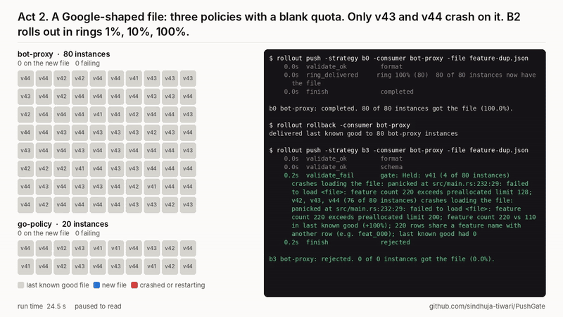

# PushGate

**Stop a bad config push before it takes down the fleet.**

[](docs/demo.mp4)

*90-second demo ([docs/demo.mp4](docs/demo.mp4)): a live run on a 100-instance fleet. The clip above is from act 2: staged rollout carries a Google-shaped file to every instance and 12 of 20 crash, then PushGate holds the same file before any instance gets it.*

## Abstract

Three of the largest outages of 2024 and 2025 (CrowdStrike, Google Cloud, Cloudflare) followed one pattern. A data or config file passed its format checks, crashed the program that loaded it, and reached every machine faster than a code release would have been allowed to. PushGate is an open-source gate for such pushes. Before any instance gets a new file, it loads the file into the actual consumer binary at every release currently deployed, replays sampled traffic plus a request built for every changed rule, and compares the result with the last known good file. Only then does it roll out in rings with alarms and rollback. We evaluate it with PushBench, a benchmark of incidents rebuilt from public postmortems, on a live simulated fleet. Across 10 bad files and 5 fleet layouts, PushGate held all 50 bad pushes before any instance got the file (100%, 95% CI 93 to 100%). Staged rollout with alarms held 10 of 50. PushGate held none of 500 safe files (0%, CI 0 to 0.8%) and cost 0.1 to 0.3 s and about 0.14 CPU-seconds per check. Two slower failures, a memory leak that takes two minutes to kill a release and a producer that flips between a good and a bad file, are also held before exposure. The same gate runs as a GitHub Action on any repository's config files.

## 1. The problem

| Incident | The file | Why checks missed it | Impact |
|---|---|---|---|
| CrowdStrike, 19 Jul 2024 | Channel File 291 | Sensor expected 20 fields, got 21: out-of-bounds read | ~8.5M Windows machines crashed |
| Google Cloud, 12 Jun 2025 | Quota policy row with blank fields | Code had no null handling and no feature flag | Global API failures, ~7 h to full recovery |
| Cloudflare, 18 Nov 2025 | Bot Management feature file | Duplicate rows doubled the file past a 200-feature preallocation | Widespread 5xx errors, ~6 h to recovery |

In every case the file was well formed, and the failure appeared only when the **real consumer** loaded it. Schema validation would have caught none of them. Staged rollout with health alarms (AWS AppConfig, Argo Rollouts, Flagger) helps, but it picks its first ring by instance, not by release. A file that breaks only some releases is caught early only if those releases happen to land in ring 0.

| Tool | Checks | When |
|---|---|---|
| JSON Schema and validators | Shape | Before rollout |
| AWS AppConfig, Argo Rollouts, Flagger | Health (alarms) | After exposure |
| ctest (OSDI 2020) | Hand-edited config values, via unit tests | Before rollout, Java systems |
| **PushGate** | **Behavior, in the real consumer, at every live release** | **Before exposure** |

Large companies almost certainly run internal versions of this. The contribution here is an **open implementation plus a benchmark anyone can rerun**, not a claim to have invented the idea.

## 2. Design

PushGate enforces one guarantee:

> No pushed file reaches more than ring 0 (1% of the fleet) unless:
>
> 1. every consumer release currently deployed loaded it in a sandbox without a crash, a limit breach, or a latency regression over budget, while replaying sampled production traffic;
> 2. its semantic diff from the last known good file stays within budget (row count, cardinality, null rate, distribution shift);
> 3. each ring stays healthy for its bake time.
>
> If any check fails, the push is held, and consumers keep or revert to the last known good file.

```
Producer pipeline (e.g. a feature file every 5 min)
   │
   ▼
1. Structural check         schema, field counts                        B1
2. Semantic diff            vs last known good: size, duplicates,       B3
                            nulls, new shapes, PSI drift
3. Consumer-in-the-loop     each deployed release loads the file,       B3
                            replays sampled traffic
   ▼
Ring 0 (1%) ─ bake ─▶ Ring 1 (10%) ─ bake ─▶ Ring 2 (100%)              B2
   │ alarm (crash, error rate, refused file)
   ▼
Rollback to last known good

Hold in step 2 or 3 ─▶ report: which releases fail, how, and how much of the fleet that is
```

**Semantic diff** ([docs/gate.md](docs/gate.md)). Compares the candidate with the last known good file. It holds only on what is almost never legitimate (duplicate keys, the file doubling) and warns on what sometimes is (a new 21-field rule, a blank quota, drift), because only running the consumer shows whether those are fatal.

**Consumer-in-the-loop sandbox** (the core idea). The fleet registry lists the releases running now, here v41 to v44. For each, PushGate starts that exact binary twice, with the candidate and with the last known good file, as isolated processes on private ports. It replays up to 1,000 recorded requests and compares crashes, error share, p99 latency, memory and answers. After the sample it sends one request built for every new or changed rule, so a rule that only a rare request reaches is still exercised. A crash, more than 1% errors, a large latency regression or memory that grows with every request holds the push. Changed answers only warn, since changed behavior is often the point of a push. A held push reads like this:

```
Held: v43, v44 (12 of 20 instances) crashes loading the file: panic: runtime error: invalid memory
address or nil pointer dereference at main.go:101 (also 1 warning(s): 3 policies enforce quota with a
blank quota block; last known good had 0)
```

**Consumer-side safety net** ([docs/lkg.md](docs/lkg.md)). A small library in Go and Rust. If a file fails to load, breaks a declared limit or (in Go) panics while loading, the consumer keeps serving the last known good file, caches it for restarts and reports the reason on `/healthz`. Fail-open or fail-closed is a per-file setting. Rollout alarms count a refusal as a failure, so a rollout cannot carry a file to 100% while consumers quietly reject it.

**In CI** ([docs/ci.md](docs/ci.md)). `gate ci` and the GitHub Action in `action.yml` run the same checks on any repository: a `pushgate.json` lists the config files and the command line of each deployed release, and every pull request that changes one of those files is checked against the base branch's version. A hold fails the check and the job summary says which releases fail and why. No simulated fleet is needed.

**Urgent lane** ([docs/gate.md](docs/gate.md#the-urgent-lane)). For content that cannot wait, such as a rule against an attack in progress, `b3-urgent` still runs the whole gate, then bakes ring 0 for 3 s with the usual alarms and goes to everyone. It refuses to start without a reason, which is recorded with the push.

**Rings and kill switch** ([docs/baselines.md](docs/baselines.md)). Rings of 1%, 10% and 100% with bake times, crash and error-rate alarms, rollback, and one command to freeze all pushes of a file type. Deliberately simple: AppConfig already does this well.

## 3. Evaluation setup

**Fleet.** A simulated fleet of real processes, 500 at full size, across four regions and four releases (v41 to v44). bot-proxy is a Rust module with a preallocated feature table, matching Cloudflare's design. go-policy is a Go quota checker, matching Google's Service Control. What differs between releases is in [docs/versions.md](docs/versions.md): for example, v41 holds 128 features and v42 to v44 hold 200, and v43 and v44 read the quota block without a nil check. A load generator sends steady traffic and records a sample for the gate to replay.

**Strategies.** B0 pushes to everyone after a format check, like the fast paths in all three incidents. B1 adds a JSON Schema. B2 is a staged rollout with alarms and rollback. B3 is PushGate: B2 plus the gate.

**Scenarios** ([docs/bench.md](docs/bench.md)). Ten bad files: the three incidents, a partial-replica Cloudflare variant, growth to 210 features, ordinary growth to 130 that only v41 cannot hold, a 21st field reached only by a rare request, a single-row Google variant, a half-written file and a wrong-type weight. Two slow scenarios run separately with longer windows: a debug-tracing rule that makes v44 leak memory until the fleet's 64 MB limit kills it, and a producer that pushes the Cloudflare file and the good file in turn every 15 s. Two good pushes through the fleet measure push delay. A corpus of 500 safe files (added, removed or retuned rules, flipped allows, new quotas) goes through the gate alone to measure false holds. A gate that holds everything scores perfectly on bad pushes and is useless, so the corpus keeps the result honest.

**Method.** Every scenario runs under every strategy on five fleet layouts. The layout seed decides which release each instance runs, and so which releases land in ring 0. The matrix uses a 100-instance fleet (80 bot-proxy, 20 go-policy) so that 240 runs fit in two hours on 4 cores. Each run watches the fleet for 25 s, with B2 baking 5 s per ring. Proportions get Wilson intervals and means over seeds get Student t intervals, both at 95%. A push counts as held when no instance received the file.

## 4. Results

Full tables: [bench/results/week7.md](bench/results/week7.md). Corpus: [bench/results/week7-good.md](bench/results/week7-good.md). Slow scenarios: [bench/results/week7-long.md](bench/results/week7-long.md).

| Strategy | Bad pushes held before exposure (95% CI) | Mean share of fleet that got a bad file | Mean failed instance-seconds per push |
|---|---|---|---|
| B0 push-all | 5 of 50, 10% (4 to 21%) | 90% | 778 ± 236 |
| B1 schema | 10 of 50, 20% (11 to 33%) | 80% | 579 ± 214 |
| B2 staged + alarms | 10 of 50, 20% (11 to 33%) | 26% | 12 ± 6 |
| **B3 PushGate** | **50 of 50, 100% (93 to 100%)** | **0%** | **0** (no run had any failure) |


**4.1 Staged rollout depends on the layout.** With the same Google file, B2 stopped at 5% of the fleet on two layouts and reached 100% on two others, where rings 0 and 1 held only v41 and v42. There, 12 of 20 go-policy instances crashed until the alarm rolled the file back. The two files that break only v41 reached the whole fleet on one layout in five. B2 still keeps damage low on average (12 failed instance-seconds per push against 778 for B0), because its alarm fires within seconds of exposure (median 7 s after the push). But how far a file gets is decided by where releases sit.


**4.2 The gate removes that variance.** B3 held every bad file on every layout, because it tests each release rather than a sample of instances. The ablations in the [development log](docs/history.md#what-week-3-shows) show which layer does the work. The diff alone holds only the Cloudflare file, which doubles and repeats every key. The 21-field rules and the blank quotas are legal changes in general, so the diff warns on them, and only running the releases shows which ones crash.

**4.3 Rare requests.** One file breaks three releases, but only on one request shape. In week 5 the gate held it in 1 of 5 runs, when the recorded traffic sample happened to contain that request; in the other four, B3 behaved like B2 and the file reached the whole fleet. The gate now builds one request for every new or changed rule, filling wildcards from a sampled request, and replays those after the sample. It held the file in 5 of 5 runs: `v41, v42, v43 (40 of 80 instances) crashes on replayed traffic: index out of bounds: the len is 20 but the index is 20`. This covers rules the producer changed. A crash that depends on a request shape unrelated to any changed rule still needs it in the sample.

**4.4 Slow failures** ([results](bench/results/week7-long.md), 3 layouts). *Memory leak:* a debug-tracing rule makes v44 keep 128 KB per matching request. Nothing crashes on load or on any request, so B2's 5 s bakes saw a healthy fleet and the push completed in 10 s on every layout. The first v44 instance hit the 64 MB memory limit about 137 s later, and every one of the 40 v44 instances was killed once in the 4-minute window. B3 held the file in 0.3 s: `v44 (40 of 80 instances) leaks memory: memory grows with every replayed request`. Rings cannot catch a failure that starts after the last bake; a sandbox that measures memory per request can. *Flapping producer:* six pushes, bad and good in turn, 15 s apart. Under B0 every bad push crashed all 80 instances again, for about 4,400 failed instance-seconds and 53% failed requests in 100 s. B2 rolled each bad push back at ring 0, so one instance failed each time (13 to 18 failed instance-seconds), but the fleet still took 246 file deliveries. B3 rejected the three bad pushes before delivery and delivered only the three good ones (240 deliveries, nothing failed).

**4.5 False holds and cost.** None of the 500 safe files was held by B1, by either gate layer alone, or by both (0%, CI 0 to 0.8%). 28% passed with a warning, mostly a new rule shape or changed answers. A check took 99 ms at p50 and 0.14 CPU-seconds with 8 sandboxed processes, or about 0.25 s on a machine also running the fleet. B3 added 0.3 s to a 10 s staged rollout for the good pushes, far under the 2-minute budget we set. The first corpus run did hold 9 safe files, which exposed a race in the gate itself: parallel sandbox processes competed for the same port. The fix (an id per run that `/healthz` must echo, and a retry on bind failure) came before the numbers above.

**4.6 The urgent lane** ([results](bench/results/urgent.md)). Run on the same 12 scenarios and 5 layouts, plus the slow scenarios on 3, `b3-urgent` held all 56 bad pushes before exposure, as B3 did, and the good pushes reached every instance in 3.4 s at the median against 10.4 s for B3 and 10.0 s for B2.

**4.7 The cheap checks still matter.** B0's format check stopped the half-written file and B1's schema stopped the wrong-type weight. Those are B0's 5 and B1's 10 holds. The gate adds to them rather than replacing them.

**4.8 The safety net works without the gate** ([week 4 results](docs/history.md#what-week-4-shows)). With the last-known-good library in every consumer, even B0 pushing the three incident files to all 500 instances crashed nothing. Each vulnerable instance refused the file with the reason, for example `feature 0 has 21 match fields; this release reads 20 input slots`, and kept serving the old one. The library needs a code release to reach every consumer, though. The gate protects the releases already running.

## 5. Limitations and threats to validity

- **A simulated fleet is not a real one.** Incidents are rebuilt from the shapes in public postmortems, not the companies' code or traffic. The consumers are small, so the sandbox is cheap. A large binary that takes seconds to start would raise the gate's cost.
- **One machine.** Timings such as the 2 s alarm and the 0.1 s check come from one 4-core machine. The seeds vary the fleet layout, not the hardware. The seeded matrix runs on 100 instances, and the three incidents were also run on 500 ([development log](docs/history.md)).
- **The scenarios were written by the same people as the gate.** Eight of ten bad files break at load time, where the sandbox is strongest. The rare-request and memory-leak scenarios were added to probe the gate's blind spots, and the gate was then extended to catch them, so they show the fix works, not that no blind spots remain. A leak that grows too slowly to show in 1,000 requests, or one triggered only by traffic the gate does not build, would still pass, and the rings and alarms remain for that.
- **The safe corpus is synthetic.** Its mutations are routine by construction. Real producers make stranger safe changes, so 0 of 500 is an optimistic bound.
- **Speed versus safety.** Security content has to move fast. The urgent lane keeps the gate but drops the 10% ring and shortens the bake, so a file that passes the gate and fails only after a few seconds reaches the whole fleet sooner than under B3.
- **Failing open is not always safe.** For auth or security rule files it may let through traffic that should be blocked. The library's `fail_closed` mode exists for those.
- **Data-triggered failures only.** PushGate does not catch ordinary code bugs or bad commands such as Facebook's 2021 BGP withdrawal.

## 6. Related work

Staged rollout with automatic rollback is standard: AWS AppConfig monitors alarms during a deployment, and Argo Rollouts and Flagger do the same for Kubernetes config. All of them judge a file after exposure. Testing configuration changes against the code that reads them was studied by Sun et al. (ctest, OSDI 2020) for hand-edited values in Java systems, through existing unit tests. Meta's Configerator (SOSP 2015) combines validators, canaries and automated testing for config changes. PushGate applies the same idea to machine-generated data files, runs the deployed binaries rather than unit tests, and measures the result against staged rollout on incidents anyone can rerun.

## 7. Reproduce it

Needs Go 1.24+, a recent stable Rust toolchain, Python 3.10+ and, for the video, ffmpeg.

```bash
make bench        # the full benchmark: corpus, 240 fleet runs, tables and charts (about 2 hours)
make bench-quick  # one fleet layout and 100 safe files (about 25 minutes)
make bench-long   # the memory-leak and flapping-producer scenarios (about an hour)
make bench-urgent # the urgent lane on every scenario (about 30 minutes)
make demo         # the demo run, live in the terminal (about 1 minute)
make demo-video   # ...and render it to docs/demo.mp4
```

`make bench` writes to `state/results/`, so you can compare with the committed `bench/results/`. `make bench RESULTS=bench/results` replaces them.

Other targets: `make build`, `make test`, `make smoke` (each incident breaks exactly the releases it should), `make bench-incidents` and `make bench-lkg` (the three incidents on 500 instances, without and with the library). The pieces also run on their own:

```bash
make fleet                                   # terminal 1: 500 instances, registry on :19000
bin/loadgen -rate 2000 -listen 127.0.0.1:19100 -record state/traffic.txt   # terminal 2: traffic and a sample
bin/pgctl status                             # who runs what, and which config each instance serves
bin/rollout set-lkg -consumer bot-proxy -file seed/feature.json
bin/gate check -consumer bot-proxy -file f.json                  # pass or hold, and why; delivers nothing
bin/rollout -loadgen http://127.0.0.1:19100 push -strategy b3 -bake 10s -consumer bot-proxy -file f.json
bin/rollout -loadgen http://127.0.0.1:19100 push -strategy b3-urgent -reason "incident 1234" -consumer bot-proxy -file f.json
bin/pgctl crashes                            # crash-looping instances, grouped by panic
bin/rollout freeze -consumer bot-proxy -reason "incident 1234"   # kill switch
bin/rollout rollback -consumer bot-proxy                         # last known good, everywhere
```

With Docker, `docker compose up --build -d` runs the fleet plus Prometheus, which scrapes all 500 instances (<http://localhost:9090>, registry at <http://localhost:19000/registry>).

## Layout

```
pushgate/
├── consumers/             bot-proxy (Rust) and go-policy (Go), built as releases v41 to v44
├── fleet/cmd/             fleet supervisor, pgctl, loadgen
├── gate/                  semantic diff, consumer-in-the-loop sandbox, held-push reports; cmd/gate
├── rollout/               B0 to B3: validators, rings, bake, alarms, rollback, kill switch; cmd/rollout
├── lib/                   last-known-good library: go/lkg and rust/lkg
├── bench/
│   ├── scenarios/         one JSON file per scenario
│   ├── cmd/               pushbench (fleet runs), goodcorpus (safe files), report (tables and charts)
│   └── results/           committed results
├── internal/registry/     fleet layout, live registry, stable rings
├── producer/              builds feature files from DuckDB, and policy files
├── scripts/               smoke test, demo and its video renderer
├── examples/ci/           a pushgate.json for gate ci, with a small Python consumer
├── action.yml             the GitHub Action (gate ci on pull requests)
├── docs/                  design notes, method, CI guide, development log, demo video
├── deploy/, seed/         fleet layout and the files every instance starts with
└── Makefile
```

## Roadmap

| Week | Deliverable |
|---|---|
| 1 ✅ | Fleet simulator and consumers: Rust and Go consumers, 500+ mixed-version processes, version registry, producer, Prometheus metrics |
| 2 ✅ | Baselines B0 to B2: push service, rings, alarm rollback, kill switch. Rebuild the three incidents and confirm B0 takes down the fleet in each |
| 3 ✅ | Gate checks: semantic diff and a sandbox with traffic replay, under 1 minute per run |
| 4 ✅ | Consumer library: last-known-good fallback, declared limits, fail-open or fail-closed, randomized reload backoff |
| 5 ✅ | PushBench runs: 10 bad scenarios (12 planned) and 500 good pushes against B0 to B3, 5 seeds, confidence intervals, charts |
| 6 ✅ | Write-up and demo: this README, a 90-second video, one-command `make bench` |
| 7 ✅ | Close blind spots: a replayed request for every changed rule, memory-growth holds, and the memory-leak and flapping-producer scenarios (12 bad scenarios) |
| 8 ✅ | Real CI use: `gate ci` and a GitHub Action for any repository's config files ([docs/ci.md](docs/ci.md)) |
| 9 ✅ | Finish: an urgent lane for content that cannot wait, MIT license, v1 release of the Action |

What each week found at the time is in [docs/history.md](docs/history.md).

## Sources

- [Cloudflare: outage on November 18, 2025](https://blog.cloudflare.com/18-november-2025-outage/)
- [Google Cloud incident report, June 12, 2025](https://status.cloud.google.com/incidents/ow5i3PPK96RduMcb1SsW)
- [CrowdStrike: Channel File 291 root cause analysis](https://crowdstrike.com/wp-content/uploads/2024/08/Executive-Summary_Root-Cause-Analysis_Channel-File-291.pdf)
- [AWS AppConfig: monitoring deployments for automatic rollback](https://docs.aws.amazon.com/appconfig/latest/userguide/monitoring-deployments.html)
- [Codefresh: progressive delivery for ConfigMaps with Argo Rollouts](https://codefresh.io/blog/progressive-delivery-for-kubernetes-config-maps-using-argo-rollouts)
- [Sun et al., Testing Configuration Changes in Context to Prevent Production Failures (OSDI 2020)](https://www.usenix.org/conference/osdi20/presentation/sun)
- [Tang et al., Holistic Configuration Management at Facebook (SOSP 2015)](https://sigops.org/s/conferences/sosp/2015/current/index.html)

The 8.5M device figure for CrowdStrike is Microsoft's public estimate from July 2024.

## License

MIT. See [LICENSE](LICENSE).
