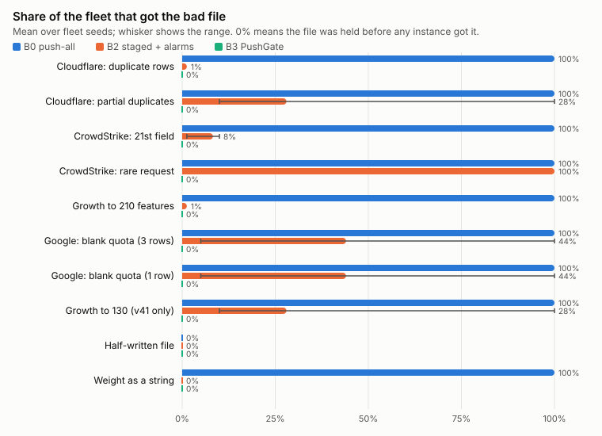
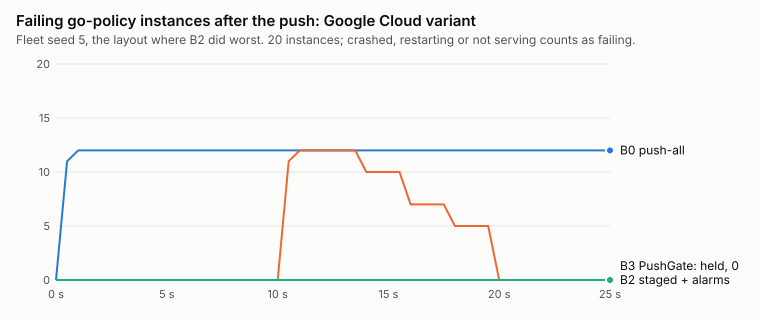

# PushBench week 7 results

Generated 2026-11-07 22:21 UTC. 10 bad scenarios and 2 good pushes, each run under B0, B1, B2, B3 on 5 fleet layouts (seeds 1, 2, 3, 4, 5). A seed changes which release each instance runs, and so which releases land in each ring. The fleet has 80 bot-proxy and 20 go-policy instances. Each run watched the fleet for 25 s after the push. Intervals are 95%: Wilson for proportions, Student t over seeds for means.

## Overall, bad pushes

| Strategy | Held before any exposure | Mean share of fleet that got the file | Mean failed instance-seconds per push | Runs where any instance failed |
|---|---|---|---|---|
| B0 | 5 of 50, 10% (4 to 21%) | 90.0 ± 8.4% | 778 ± 236 | 43 of 50, 86% (74 to 93%) |
| B1 | 10 of 50, 20% (11 to 33%) | 80.0 ± 11.2% | 579 ± 214 | 39 of 50, 78% (65 to 87%) |
| B2 | 10 of 50, 20% (11 to 33%) | 25.5 ± 11.1% | 12 ± 6 | 40 of 50, 80% (67 to 89%) |
| B3 | 50 of 50, 100% (93 to 100%) | 0.0% | 0 | 0 of 50, 0% (0 to 7%) |

## Per scenario

Held: runs where no instance got the file. Got the file and failed instance-seconds are means over seeds, with the 95% interval.

| Scenario | Breaks | Strategy | Held | Got the file | Peak failing | Failed instance-seconds | Failed requests |
|---|---|---|---|---|---|---|---|
| Cloudflare, 18 Nov 2025 (`cloudflare-duplicate-rows`) | 100% of fleet | B0 | 0 of 5 | 100% | 100% | 2000 | 99.9 ± 0.1% |
|  |  | B1 | 0 of 5 | 100% | 100% | 1999 ± 1 | 99.9 ± 0.2% |
|  |  | B2 | 0 of 5 | 1% | 1% | 7 ± 2 | 0.3 ± 0.1% |
|  |  | B3 | 5 of 5 | 0% | 0% | 0 | 0.0% |
| Cloudflare variant (`cloudflare-partial-replica`) | 5% of fleet | B0 | 0 of 5 | 100% | 5% | 100 | 5.0 ± 0.1% |
|  |  | B1 | 0 of 5 | 100% | 5% | 100 | 4.9 ± 0.1% |
|  |  | B2 | 0 of 5 | 28 ± 50% | 2 ± 2% | 8 ± 8 | 0.3 ± 0.3% |
|  |  | B3 | 5 of 5 | 0% | 0% | 0 | 0.0% |
| CrowdStrike, 19 Jul 2024 (`crowdstrike-extra-field`) | 50% of fleet | B0 | 0 of 5 | 100% | 50% | 984 ± 7 | 47.6 ± 0.5% |
|  |  | B1 | 0 of 5 | 100% | 50% | 987 ± 5 | 48.8 ± 0.4% |
|  |  | B2 | 0 of 5 | 8 ± 5% | 4 ± 3% | 21 ± 16 | 1.0 ± 0.8% |
|  |  | B3 | 5 of 5 | 0% | 0% | 0 | 0.0% |
| CrowdStrike variant (`crowdstrike-rare-request`) | 50% of fleet | B0 | 0 of 5 | 100% | 1 ± 1% | 2 ± 4 | 0.0% |
|  |  | B1 | 0 of 5 | 100% | 2 ± 2% | 3 ± 2 | 0.0% |
|  |  | B2 | 0 of 5 | 100% | 1% | 3 ± 2 | 0.0% |
|  |  | B3 | 5 of 5 | 0% | 0% | 0 | 0.0% |
| Growth past the limit (`feature-explosion`) | 100% of fleet | B0 | 0 of 5 | 100% | 100% | 1999 ± 1 | 99.9 ± 0.2% |
|  |  | B1 | 0 of 5 | 100% | 100% | 1999 ± 1 | 100.0% |
|  |  | B2 | 0 of 5 | 1% | 1% | 6 ± 3 | 0.2 ± 0.1% |
|  |  | B3 | 5 of 5 | 0% | 0% | 0 | 0.0% |
| Google Cloud, 12 Jun 2025 (`google-blank-quota`) | 60% of fleet | B0 | 0 of 5 | 100% | 60% | 300 | 59.6 ± 0.6% |
|  |  | B1 | 0 of 5 | 100% | 60% | 300 | 59.8 ± 0.9% |
|  |  | B2 | 0 of 5 | 44 ± 64% | 27 ± 37% | 32 ± 43 | 5.8 ± 7.6% |
|  |  | B3 | 5 of 5 | 0% | 0% | 0 | 0.0% |
| Google Cloud variant (`google-single-row`) | 60% of fleet | B0 | 0 of 5 | 100% | 60% | 300 | 60.1 ± 1.0% |
|  |  | B1 | 0 of 5 | 100% | 60% | 300 | 59.9 ± 0.7% |
|  |  | B2 | 0 of 5 | 44 ± 64% | 27 ± 37% | 36 ± 47 | 6.4 ± 7.9% |
|  |  | B3 | 5 of 5 | 0% | 0% | 0 | 0.0% |
| Normal growth, old release (`growth-past-v41`) | 5% of fleet | B0 | 0 of 5 | 100% | 5% | 100 | 4.9 ± 0.1% |
|  |  | B1 | 0 of 5 | 100% | 5% | 100 | 5.0 ± 0.2% |
|  |  | B2 | 0 of 5 | 28 ± 50% | 2 ± 2% | 9 ± 10 | 0.4 ± 0.5% |
|  |  | B3 | 5 of 5 | 0% | 0% | 0 | 0.0% |
| Half-written file (`truncated-file`) | 100% of fleet | B0 | 5 of 5 | 0% | 0% | 0 | 0.0% |
|  |  | B1 | 5 of 5 | 0% | 0% | 0 | 0.0% |
|  |  | B2 | 5 of 5 | 0% | 0% | 0 | 0.0% |
|  |  | B3 | 5 of 5 | 0% | 0% | 0 | 0.0% |
| Type error (`wrong-type-weight`) | 100% of fleet | B0 | 0 of 5 | 100% | 100% | 1999 ± 1 | 100.0% |
|  |  | B1 | 5 of 5 | 0% | 0% | 0 | 0.0% |
|  |  | B2 | 5 of 5 | 0% | 0% | 0 | 0.0% |
|  |  | B3 | 5 of 5 | 0% | 0% | 0 | 0.0% |

## Good pushes through the fleet

A good push should complete. Push delay is the time from the push to every instance having the file.

| Strategy | Completed | Held or rolled back | Push delay p50 / max | Gate time p50 |
|---|---|---|---|---|
| B0 | 10 of 10 | 0 | 0.0 s / 0.1 s | – |
| B1 | 10 of 10 | 0 | 0.0 s / 0.1 s | – |
| B2 | 10 of 10 | 0 | 10.0 s / 10.1 s | – |
| B3 | 10 of 10 | 0 | 10.4 s / 10.4 s | 301 ms |

## Good-push corpus (gate only)

500 safe files, run through the checks without a fleet ([details](week7-good.md)).

| Check | False holds | Rate (95% CI) |
|---|---|---|
| B1 schema | 0 of 500 | 0.0% (0.0 to 0.8%) |
| Gate, diff only | 0 of 500 | 0.0% (0.0 to 0.8%) |
| Gate, sandbox only | 0 of 500 | 0.0% (0.0 to 0.8%) |
| Gate, both layers (B3) | 0 of 500 | 0.0% (0.0 to 0.8%) |

Gate cost: 0.14 CPU-seconds per push on average, 99 ms wall time at p50 and 120 ms at p95.

## Where ring 0 luck decided B2

- **Cloudflare variant**: B2 exposed between 10% and 100% of the fleet depending on the layout (seed 1: 100%, seed 2: 10%, seed 3: 10%, seed 4: 10%, seed 5: 10%).
- **CrowdStrike, 19 Jul 2024**: B2 exposed between 1% and 10% of the fleet depending on the layout (seed 1: 1%, seed 2: 10%, seed 3: 10%, seed 4: 10%, seed 5: 10%).
- **Google Cloud, 12 Jun 2025**: B2 exposed between 5% and 100% of the fleet depending on the layout (seed 1: 100%, seed 2: 5%, seed 3: 10%, seed 4: 5%, seed 5: 100%).
- **Google Cloud variant**: B2 exposed between 5% and 100% of the fleet depending on the layout (seed 1: 100%, seed 2: 5%, seed 3: 10%, seed 4: 5%, seed 5: 100%).
- **Normal growth, old release**: B2 exposed between 10% and 100% of the fleet depending on the layout (seed 1: 100%, seed 2: 10%, seed 3: 10%, seed 4: 10%, seed 5: 10%).

