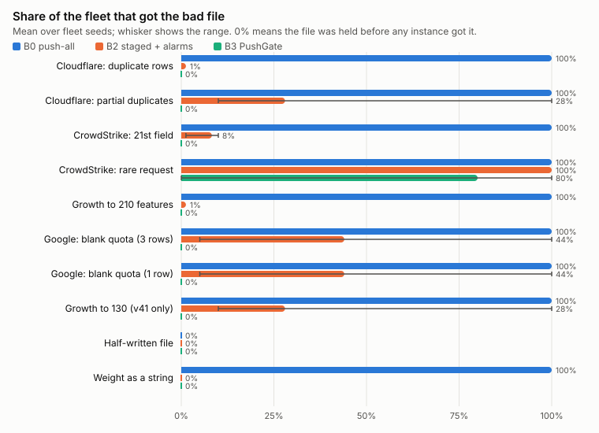

# Development log

PushGate was built in six weekly steps. Each section below is what that week's
benchmark showed at the time, kept as written. The [README](../README.md)
summarizes the final results.

## What week 1 shows

`make smoke` on a 4-core machine, 500 instances, 2,000 requests per second, no gate:

| Scenario | Bad file | Crashed |
|---|---|---|
| Cloudflare | Producer query returns every feature twice (110 → 220) | bot-proxy v41, v42, v43, v44: 100% |
| CrowdStrike | 5 rules gain a 21st match field | bot-proxy v41 to v43: 100%. v44: 0% |
| Google Cloud | 3 policy rows with `enforce_quota` and a blank quota | go-policy v43, v44: 100%. v41, v42: 0% |

Each push reached every instance of that consumer in under a second. Rolling back recovered the fleet in about 9 seconds, mostly restart backoff. The Cloudflare file comes from a real SQL flaw: the producer's metadata query filters on table name but not schema, so making a second schema visible doubles its output.

One side effect: with Rust backtraces turned on, 400 crash-looping instances spent enough CPU symbolizing backtraces to stall a 4-core machine. That echoes Cloudflare's finding that error reporting made their outage worse. The supervisor turns backtraces off by default (`-backtraces` turns them back on).

## What week 2 shows

`make bench` (now `make bench-incidents`) on the same machine, 500 instances, 2,000 requests per second, each run watched for 45 s, B2 baking 10 s per ring ([full table](../bench/results/week2.md)):

| Incident | B0 push-all | B1 schema | B2 staged + alarms |
|---|---|---|---|
| Cloudflare (bot-proxy, 400) | 400 failing, 100% of requests failed | same as B0 | 4 exposed, alarm at 2 s, rolled back. 0.1% of requests failed |
| CrowdStrike (bot-proxy, 400) | 200 failing, 46% of requests failed | same as B0 | 4 exposed, alarm at 2 s, rolled back. 0.1% failed |
| Google Cloud (go-policy, 100) | 68 failing, 68% of requests failed | same as B0 | 1 exposed, alarm at 2 s, rolled back. 0.2% failed |

Three things stand out:

- **B1's schema caught none of them.** Each bad file is legal in its format. The limits it broke live in consumer code.
- **B2 works well when ring 0 holds a release the file breaks.** At this fleet size, the 1% ring happened to include a vulnerable release in all three cases.
- **It is luck, not design.** On a 100-instance fleet ([table](../bench/results/week2-small-fleet.md)), the Google-shaped file reached ring 0 and ring 1 on safe releases only (v41, v42). B2 rolled it out to 100% before the alarm fired, and 60% of that fleet crashed. The CrowdStrike file got past ring 0 the same way. Week 5 measures this across many fleet layouts.

## What week 3 shows

Same machine and settings as week 2, now with B3 and two ablations that run one gate layer each ([full table](../bench/results/week3.md), [100-instance fleet](../bench/results/week3-small-fleet.md)):

| Incident | B2 staged + alarms | B3 PushGate | B3 diff only | B3 sandbox only |
|---|---|---|---|---|
| Cloudflare | 4 exposed, rolled back | **held, 0 exposed** (diff and sandbox) | held | held |
| CrowdStrike | 4 exposed, rolled back | **held, 0 exposed** (sandbox) | warned, passed: 4 exposed, rolled back | held |
| Google Cloud | 1 exposed, rolled back | **held, 0 exposed** (sandbox) | warned, passed: 1 exposed, rolled back | held |

- **B3 held every bad file before any instance got it,** on the 500- and the 100-instance fleet. On the small fleet B2 again let the Google file reach 100% (12 of 20 go-policy instances crashed) and the CrowdStrike file reach 10%; B3 exposed nothing. Ring 0 luck no longer decides these shapes. Each check took 0.2 to 0.3 s against a one-minute budget.
- **The sandbox does the work.** The diff alone catches only the Cloudflare file. It sees the 21-field rules and the blank quotas, but those are legal changes in general, so it warns rather than holds. Only running v41 to v44 shows which releases crash, which is the project's central claim.
- **The report says what would have happened.** For CrowdStrike: v41, v42 and v43 (200 of 400 instances) crash on the second replayed request with an index out of bounds at `main.rs:108`, while v44 is fine.
- **Good pushes:** week 3 checked only identical files and 10% growth. Week 5 ran 500 safe files through the gate, and none were held.

## What week 4 shows

The same benchmark with every consumer loading through the last-known-good library ([full table](../bench/results/week4.md), [100-instance fleet](../bench/results/week4-small-fleet.md), [fail-closed](../bench/results/week4-fail-closed.md)):

| Incident | B0 push-all, no library | B0 push-all + library | B2 + library | B3 + library |
|---|---|---|---|---|
| Cloudflare | 400 failing, 100% of requests failed | 400 refused the file, 0 failing, 0% failed | 4 refused, rejection alarm at 3 s, rolled back | held by the gate, 0 exposed |
| CrowdStrike | 200 failing, 46% failed | 200 refused (v41 to v43), 0 failing, 0% failed | 2 refused, alarm at 3 s, rolled back | held, 0 exposed |
| Google Cloud | 68 failing, 68% failed | 68 refused (v43, v44), 0 failing, 0% failed | 1 refused, alarm at 2 s, rolled back | held, 0 exposed |

- **The library turns a fleet-wide outage into a non-event.** Pushed to everyone at once, all three files crashed nothing: each vulnerable instance rejected the file with the reason, for example `feature 0 has 21 match fields; this release reads 20 input slots`, and kept serving the old one.
- **Silent rejection is its own risk, so rejections raise the alarm.** Without that, B2 would treat an instance that refuses the file as healthy and carry it to 100%. With it, B2 rolled back at ring 0. On the 100-instance fleet, B2 still reached 100% with the Google file, because rings 0 and 1 again held only safe releases. Nothing failed, but 12 of 20 instances were left on stale config until the alarm fired at 14 s. The gate catches that case before exposure.
- **Fail-closed trades availability for safety, as designed.** With `fail_closed`, B0 failed about as many requests as with no library, since refusing instances answer 503, but nothing crash-looped. B2 recovered in 3 to 6.5 s.
- **Rust panics cannot be caught** (`panic = "abort"`), so bot-proxy relies on declared limits. Go's library also catches panics: go-policy's unchanged v43 code still hits the nil quota, and the library turns that into a rejection naming `main.go:101`.

## What week 5 shows

Every scenario under B0 to B3 on five fleet layouts of 100 instances ([full tables](../bench/results/week5.md), [method](bench.md)):

| Strategy | Bad pushes held before exposure (95% CI) | Mean share of fleet that got a bad file | Mean failed instance-seconds |
|---|---|---|---|
| B0 push-all | 5 of 50, 10% (4 to 21%) | 90% | 778 ± 236 |
| B1 schema | 10 of 50, 20% (11 to 33%) | 80% | 579 ± 213 |
| B2 staged + alarms | 10 of 50, 20% (11 to 33%) | 26% | 13 ± 6 |
| B3 PushGate | 46 of 50, 92% (81 to 97%) | 8% | 0 (3 runs had any failure) |

- **B2's result depends on the layout.** With the same Google file, B2 stopped at 5% of the fleet on two layouts and reached 100% on two others, where rings 0 and 1 held only safe releases. On those, 12 of 20 go-policy instances crashed until the alarm rolled it back, about 10 s later. The same happened to the two v41-only files on one layout in five.
- **B3 removed that variance.** It held every file that the deployed releases fail on with ordinary traffic, on every layout, because it tests each release rather than a sample of instances.
- **The gate is only as good as its traffic sample.** The rare-request file breaks three releases but only on one request shape. The gate held it once in five runs, when the recorded sample happened to contain that request. In the other four it passed, and B3 behaved like B2: the crashes were too rare to trip the alarm, and the file reached the whole fleet.
- **No false holds in 500 safe files** (0%, CI 0 to 0.8%). 28% passed with a warning, mostly a new 21-field shape or changed answers, which is the point of warn over hold. The gate cost 0.13 CPU-seconds and 95 ms per check.
- **The corpus found a gate bug first.** The first run held 9 safe files: parallel sandbox processes raced for the same port, and once a replay hit the wrong process. The fix (own id per run, retry on bind failure) is in this week, and the numbers above are after it.
- **The cheap checks still matter.** B0's format check stopped the half-written file and B1's schema stopped the wrong-type weight. The gate adds to them rather than replacing them.

## What week 7 shows

The rerun with targeted requests and the memory check ([full tables](../bench/results/week7.md), [slow scenarios](../bench/results/week7-long.md)):

- **The rare-request miss is closed.** B3 held all 50 bad pushes (100%, CI 93 to 100%), up from 46. The gate now replays one request built for every new or changed rule after the sample, so the 21-field rule is reached on every layout, not only when the recorded sample happens to contain its request shape.
- **No new false holds.** The 500 safe files still pass (0 of 500). A check took 99 ms at p50 and 0.14 CPU-seconds, against 95 ms and 0.13 in week 5.
- **Rings cannot see a slow leak.** With debug tracing on, v44 grows about 0.5 MB a second under load. B2's bakes saw a healthy fleet and completed the push in 10 s; the first instance hit the 64 MB limit about 137 s later. The gate held it in 0.3 s because v44's memory grows with every replayed request while the last known good file's does not.
- **A flapping producer multiplies the cost of every strategy without a gate.** B0 crashed the whole fleet three times in 100 s. B2 limited each bad push to one instance, but still delivered 246 files. B3 delivered only the three good files.
- **A harness bug found on the way.** Runs of one seed share a fleet, and a leaking process keeps its memory after a rollback. The first B1 and B2 memory-leak runs therefore started half full and failed sooner. B2 was rerun on fresh fleets, and PushBench now restarts the fleet around every run of a long scenario.

## What week 8 adds

`gate ci` and a GitHub Action run the gate on any repository without the simulated fleet ([docs/ci.md](ci.md)). A `pushgate.json` lists config files and the command line of each deployed release; each pull request that changes one of those files is replayed against every release and compared with the base branch's version. `examples/ci/` has a 70-line Python rate limiter whose release 1 divides by a limit's `burst`, and `scripts/test_gate_ci.sh` (run in CI) checks that five known-bad files are held and two good ones pass. The `pushgate` workflow runs the action on pull requests that touch `examples/ci/`, the gate or the action itself.
